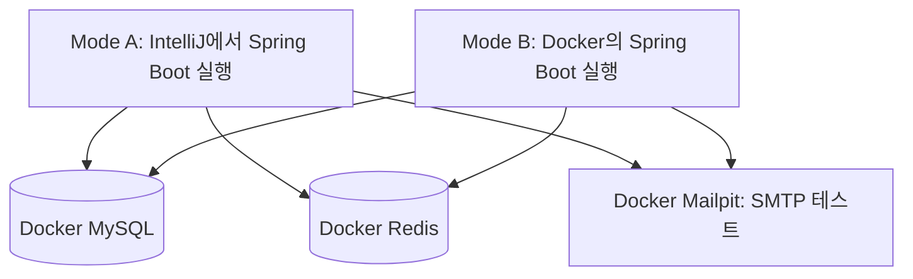
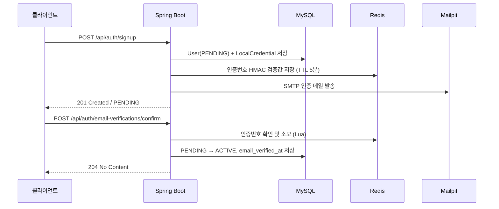

# Auth Lab

Spring Boot 기반의 **인증(Authentication)·인가(Authorization)·멀티테넌트(Multi-Tenancy) 학습 프로젝트**입니다.

일반 이메일 로그인과 Google OAuth2/OIDC를 하나의 사용자 계정에 연결하고, JWT·Redis를 이용한 로그인 세션 관리 및 여러 조직에 소속된 사용자의 권한 분리를 단계적으로 구현하는 것이 목표입니다.

> **현재 단계:** **STEP 6-5 완료.** Mode A(IntelliJ)·Mode B(전체 Docker)를 지원하며, Flyway V1~V3로 **업무 테이블 9개**를 생성했습니다. 인증 도메인 *
*JPA Entity 3개·Enum 2개·Repository 3개**와 매핑 테스트에 이어, **일반 회원가입 API, BCrypt 비밀번호 해싱, Mailpit 이메일 발송, Redis 기반 6자리 인증번호(5분
> TTL), 회원 상태 `PENDING → ACTIVE`**를 구현했습니다. 정상·실패 시나리오를 수동 검증하고 GitHub에 Push했습니다. **일반 로그인, JWT, Google OIDC, 테넌트/지점 비즈니스
기능은 구현 전**입니다.

## 1. 기술 스택

| 분류                      | 기술                                                                                         |
|-------------------------|--------------------------------------------------------------------------------------------|
| Language                | Java 25 (Eclipse Temurin)                                                                  |
| Framework               | Spring Boot 4.1.2                                                                          |
| Build                   | Gradle (Groovy DSL)                                                                        |
| Web / Security          | Spring Web MVC, Spring Security, Bean Validation, PasswordEncoder (BCrypt)                 |
| Persistence / Migration | Spring Data JPA, Hibernate ORM, MySQL 8.4, Flyway                                          |
| In-memory Store         | Redis 8 — 이메일 인증번호 검증값·만료·재발송 제한                                                           |
| Mail                    | Spring Mail (SMTP), Mailpit (개발용 메일 수신)                                                    |
| Infrastructure          | Docker, Docker Compose                                                                     |
| Development             | IntelliJ IDEA, Git, GitHub                                                                 |
| Testing                 | JUnit, Spring Boot Test, JPA 통합 테스트(개발용 MySQL), 회원가입·이메일 인증 수동 API 테스트                     |
| 구현 예정                   | 이메일·비밀번호 로그인, JWT (Resource Server), Google OAuth2/OIDC, 테넌트 API, Testcontainers 기반 테스트 격리 |

## 2. 프로젝트 목표

- 이메일·비밀번호 회원가입 및 로그인, 6자리 이메일 인증(5분 유효) — **회원가입·이메일 인증까지 구현 완료**, 로그인 예정
- Google OAuth2/OIDC 로그인 및 기존 계정과의 **수동 연동**
    - 서비스 로그인 이메일과 Google 이메일이 달라도 명시적 연동 허용
    - Google 계정 식별에는 이메일이 아닌 OIDC `sub` 사용
- 공통 `TokenService` 기반 JWT Access Token 발급
- Redis 기반 Refresh Token 관리, Rotation 및 로그아웃
- 하나의 사용자가 여러 테넌트에 소속되는 N:M 모델
    - 조직별 `OWNER` / `ADMIN` / `MEMBER` 역할 관리
    - API 요청은 하나의 테넌트 범위에서 처리하고, 소속·권한·데이터 접근 검증
- 간단한 공지사항 도메인을 통한 테넌트 간 데이터 격리 테스트

**DB 방식:** Shared Database + Shared Schema. `users`와 테넌트 소속을 분리하며, 테넌트 소유 데이터는 `tenant_id`로 구분할 예정입니다.

> `branches` 및 `branch_memberships`는 **Flyway V3로 실제 DB 테이블까지 생성**했습니다. 다만 지점 관련 JPA
> Entity·Repository·Service·Controller·API·권한 기능은 이후 단계에서 구현합니다.

## 3. 개발 환경 구성

Spring Boot 실행 방식을 두 가지로 지원합니다. 두 모드는 **동일한 Docker MySQL·Redis·Mailpit 서비스**를 사용하며, MySQL·Redis 데이터 볼륨을 공유합니다.



| 항목                      | Mode A — 로컬 개발       | Mode B — 전체 Docker    |
|-------------------------|----------------------|-----------------------|
| Spring Boot             | IntelliJ에서 Run/Debug | Docker 컨테이너           |
| MySQL                   | Docker               | Docker                |
| Redis                   | Docker               | Docker                |
| Mailpit (SMTP / Web UI) | Docker               | Docker                |
| 목적                      | 기능 개발 및 브레이크포인트 디버깅  | 컨테이너 빌드·네트워크·통합 실행 검증 |
| Spring Profile          | `local` (기본값)        | `docker`              |

### 포트 및 접속 주소

| 서비스            | Mac 호스트에서 접근             | Docker 내부에서 접근  |
|----------------|--------------------------|-----------------|
| Spring Boot    | `http://localhost:18080` | `backend:18080` |
| MySQL          | `127.0.0.1:23316`        | `mysql:3306`    |
| Redis          | `127.0.0.1:26379`        | `redis:6379`    |
| Mailpit SMTP   | `127.0.0.1:21025`        | `mailpit:1025`  |
| Mailpit Web UI | `http://localhost:28025` | `mailpit:8025`  |

컨테이너 내부의 `localhost`는 해당 컨테이너 자신을 가리킵니다. 그래서 Docker 실행 시 MySQL·Redis 연결에는 **Compose 서비스 이름**을 사용합니다.

## 4. 실행 전 준비

필요한 도구:

- Git
- Docker Desktop (또는 Docker Engine + Docker Compose)
- IntelliJ IDEA 및 JDK 25: **Mode A**에서 필요
- **Mode B**만 실행한다면 호스트에 JDK·Gradle을 별도로 설치할 필요 없음

### 4-1. 환경변수 설정

프로젝트 루트에서 다음 명령어를 실행합니다.

```bash
cp .env.example .env
```

`.env`에 데이터베이스·Redis 비밀번호를 설정합니다. 예시는 다음과 같습니다.

```dotenv
MYSQL_DATABASE=auth_lab
MYSQL_USER=auth_user
MYSQL_PASSWORD=your_mysql_password
MYSQL_ROOT_PASSWORD=your_mysql_root_password
REDIS_PASSWORD=your_redis_password
EMAIL_CODE_HMAC_KEY=your_64_character_hex_secret
```

랜덤 비밀번호 생성 예시:

```bash
openssl rand -hex 24
# EMAIL_CODE_HMAC_KEY용 (32바이트 = 64자리 hex)
openssl rand -hex 32
```

`EMAIL_CODE_HMAC_KEY`는 짧은 인증번호를 HMAC-SHA256 검증값으로 바꿀 때 사용하는 **비밀키**입니다. `.env`는 Git에 올리지 않습니다. 공유 가능한 변수 목록은
`.env.example`에 유지합니다. 이미 MySQL 데이터 볼륨을 생성했다면 `.env`의 초기화용 비밀번호를 변경하는 것만으로 기존 DB 계정 비밀번호가 자동 변경되지는 않습니다.

### 4-2. 설정 파일 역할

| 파일                                 | 역할                                                                                                                                    |
|------------------------------------|---------------------------------------------------------------------------------------------------------------------------------------|
| `application.yml`                  | 공통 설정, 기본 Profile `local`, Flyway 활성화, JPA `ddl-auto=validate`, 메일 발신자(`app.mail.from`), HMAC 키(`app.email-verification.hmac-secret`) |
| `application-local.yml`            | IntelliJ 실행 시 호스트 포트 사용, 프로젝트 루트 `.env` 읽기, Mailpit SMTP `127.0.0.1:21025`                                                            |
| `application-docker.yml`           | Docker 서비스 이름(`mysql`, `redis`, `mailpit`)으로 접속, SMTP `mailpit:1025`                                                                  |
| `compose.yaml`                     | MySQL·Redis·Mailpit·backend 서비스 및 `full` Profile 정의                                                                                   |
| `Dockerfile`                       | JDK 25 빌드 / JRE 25 실행의 멀티스테이지 이미지                                                                                                     |
| `.dockerignore`                    | 이미지 빌드 시 불필요한 파일과 비밀정보 제외                                                                                                             |
| `src/main/resources/db/migration/` | Flyway 버전별 SQL (`V1`, `V2`, `V3`)                                                                                                     |

## 5. Mode A — IntelliJ에서 Spring Boot 실행

평소 코드 작성 및 Spring Security 디버깅 시 사용하는 방식입니다.

**1. MySQL·Redis·Mailpit 실행**

```bash
docker compose config --quiet
docker compose up -d
docker compose ps
```

`backend` 서비스에는 `full` Profile이 설정되어 있어 위 명령어만으로는 실행되지 않습니다.

**2. IntelliJ Run/Debug Configuration**

- Main class: `com.example.authlab.AuthLabApplication`
- JDK: Java 25
- Working directory: `$PROJECT_DIR$`
- Spring Profile: `local` (지정하지 않으면 기본 적용)

`application-local.yml`이 프로젝트 루트의 `.env`를 읽으므로 **Working directory를 프로젝트 루트로 설정**해야 합니다.

**3. IntelliJ에서 Run 또는 Debug 실행**

Spring Boot가 Mac에서 실행되고, MySQL·Redis·Mailpit은 Docker에서 동작합니다.

**4. 연결 확인**

```bash
curl -i http://localhost:18080/actuator/health
```

예상되는 전체 상태는 `"status":"UP"`이며, Health 응답에서 `db`, `redis` 항목이 모두 `UP`인지 확인합니다. 출력되는 구성요소는 설정과 환경에 따라 달라질 수 있습니다.

## 6. Mode B — Spring Boot까지 Docker에서 실행

Docker 이미지 빌드와 네 서비스(backend·MySQL·Redis·Mailpit)의 통합 실행을 확인하는 방식입니다.

**1. IntelliJ에서 실행 중인 Spring Boot 종료**

호스트의 `18080` 포트를 Docker backend와 동시에 사용할 수 없으므로 먼저 종료합니다.

**2. 전체 빌드 및 실행**

```bash
docker compose --profile full up -d --build
```

**3. 컨테이너 상태·로그 확인**

```bash
docker compose --profile full ps
docker compose logs -f backend
```

로그 확인에서 `Ctrl + C`를 누르면 로그 출력만 종료되며 컨테이너는 계속 실행됩니다.

**4. API 및 JVM 확인**

```bash
curl -i http://localhost:18080/actuator/health
docker compose exec backend java -version
```

Spring Boot는 Docker 내부에서 `docker` Profile로 실행되며, MySQL은 `mysql:3306`, Redis는 `redis:6379`, Mailpit은 `mailpit:1025`로
연결합니다. Mailpit 웹 화면은 호스트의 `http://localhost:28025`에서 열 수 있습니다.

## 7. 두 실행 모드 전환

**Mode B → Mode A**

```bash
docker compose stop backend
docker compose up -d
```

그다음 IntelliJ에서 Spring Boot를 실행합니다. MySQL·Redis·Mailpit은 계속 실행됩니다.

**Mode A → Mode B**

IntelliJ에서 Spring Boot를 먼저 종료한 뒤:

```bash
docker compose --profile full up -d --build
```

**Java 소스 수정 후 Docker backend만 재빌드**

```bash
docker compose --profile full up -d --build backend
```

`docker compose restart backend`는 변경된 Java 코드를 다시 빌드하지 않습니다.

**전체 종료(데이터 볼륨 유지)**

```bash
docker compose --profile full down
```

`docker compose down -v`는 MySQL·Redis 데이터 볼륨까지 삭제하므로 주의합니다.

## 8. 데이터베이스 및 Flyway 마이그레이션

DB는 **Shared Database + Shared Schema** 방식이며, Flyway가 스키마 변경을 관리합니다. Hibernate의 `ddl-auto`는 `validate`로 설정해 **현재 작성된 인증
Entity 3개의 DB 매핑**을 검사합니다. 아직 Entity를 만들지 않은 테넌트·지점 등 나머지 테이블의 전체 구조를 검증하는 것은 아닙니다.

### 8-1. 마이그레이션 구성

```text
src/main/resources/db/migration/
├── V1__create_auth_tables.sql
├── V2__create_tenant_tables.sql
└── V3__create_branch_tables.sql
```

| Flyway 버전 | 테이블                                                              | 내용                | 상태                      |
|-----------|------------------------------------------------------------------|-------------------|-------------------------|
| V1        | `users`, `local_credentials`, `oauth_accounts`                   | 회원 및 인증 정보        | 적용 완료                   |
| V2        | `tenants`, `tenant_memberships`, `tenant_invitations`, `notices` | 조직, 소속/역할, 초대, 공지 | 적용 완료                   |
| V3        | `branches`, `branch_memberships`                                 | 조직별 지점 및 지점 배정    | **테이블 생성 완료, 기능 구현 보류** |

총 **업무 테이블 9개**에 Flyway 관리 테이블 `flyway_schema_history`를 더해 **10개 테이블**이 생성되었습니다.

### 8-2. 마이그레이션 실행 방법

Spring Boot를 시작하면 미적용 SQL 마이그레이션이 자동 실행됩니다. 두 실행 모드 모두 **동일한 MySQL 데이터 볼륨**을 사용하므로 한 모드에서 적용한 마이그레이션은 다른 모드에서 중복 실행되지
않습니다.

**Mode A (IntelliJ):**

```bash
docker compose up -d mysql redis
```

그다음 IntelliJ에서 `AuthLab - Local`을 Run/Debug로 실행합니다.

**Mode B (전체 Docker):**

IntelliJ의 Spring Boot를 종료하고 다음 명령어를 실행합니다.

```bash
docker compose --profile full up -d --build
```

### 8-3. DB 및 Flyway 실행 이력 확인

```bash
docker compose exec mysql mysql -u auth_user -p auth_lab
```

MySQL 콘솔에서:

```sql
SHOW TABLES;

SELECT version, description, success
FROM flyway_schema_history
ORDER BY installed_rank;
```

V1·V2·V3의 `success`가 모두 `1`이면 정상 적용된 상태입니다. Mode A와 Mode B에서 실행 및 테이블 생성을 확인했습니다.

**마이그레이션 관리 원칙:** 이미 적용된 V1~V3 SQL은 임의로 수정하지 않고, 이후 스키마 변경 시 **새로운 버전(`V4__...sql` 등)** 을 추가합니다.
`docker compose down -v`는 DB·Redis 볼륨을 삭제하므로 사용에 주의합니다.

---

## 9. 인증 도메인 JPA Entity 및 Repository (STEP 6-4)

Flyway로 생성한 **기존 스키마를 변경하지 않고**, 회원 인증에 필요한 세 테이블을 JPA Entity와 매핑했습니다. 이 매핑을 바탕으로 STEP 6-5에서 회원가입·이메일 인증 API를 구현했으며, 일반
로그인은 다음 단계에서 구현할 예정입니다.

### 9-1. 소스 구조

```text
src/main/java/com/example/authlab/
└── user/
    ├── entity/
    │   ├── User.java
    │   ├── UserStatus.java
    │   ├── LocalCredential.java
    │   ├── OAuthAccount.java
    │   └── OAuthProvider.java
    └── repository/
        ├── UserRepository.java
        ├── LocalCredentialRepository.java
        └── OAuthAccountRepository.java

src/test/java/com/example/authlab/
└── user/
    └── AuthEntityMappingTest.java
```

### 9-2. Entity와 관계

| Entity            | MySQL 테이블           | 핵심 설계                                                                  |
|-------------------|---------------------|------------------------------------------------------------------------|
| `User`            | `users`             | `BIGINT AUTO_INCREMENT` PK, 이메일 고유성, `PENDING`/`ACTIVE`/`SUSPENDED` 상태 |
| `LocalCredential` | `local_credentials` | `user_id`가 PK이자 FK인 **공유 기본키 일대일 관계** (`@MapsId`)                      |
| `OAuthAccount`    | `oauth_accounts`    | 회원과 다대일 관계, `provider` + `provider_user_id`로 외부 계정 식별                  |

- `UserStatus`: `PENDING`, `ACTIVE`, `SUSPENDED`
- `OAuthProvider`: 현재 `GOOGLE`만 지원
- `LocalCredential`과 `OAuthAccount`에서 `User`를 참조하는 **단방향 연관관계**를 채택했습니다.
- 연관관계는 `FetchType.LAZY`를 사용하고, Entity에 무분별한 Setter를 공개하지 않습니다.
- `User.registerLocal()`, `User.registerGoogle()`, `User.verifyEmail()` 등의 메서드로 도메인 상태 변경 의도를 나타냅니다.
- Hibernate의 문자열 Enum 매핑을 Flyway의 `VARCHAR` 컬럼과 맞추기 위해 `@Enumerated(EnumType.STRING)` 및
  `@JdbcTypeCode(SqlTypes.VARCHAR)`를 사용했습니다.
- `created_at`, `updated_at`, `linked_at` 등 일부 시각 컬럼은 DB 기본값으로 관리합니다. DB 생성값이 필요한 경우 다시 조회해야 할 수 있습니다.

`LocalCredential.password_hash`에는 STEP 6-5에서 `PasswordEncoder`가 생성한 **BCrypt 해시**를 저장합니다. 이메일·비밀번호 비교를 통한 실제 로그인 기능은 아직
구현하지 않았습니다.

### 9-3. Repository

| Repository                  | 주요 조회 기능                                                      |
|-----------------------------|---------------------------------------------------------------|
| `UserRepository`            | `findByEmail`, `existsByEmail`                                |
| `LocalCredentialRepository` | 공유 PK인 `userId`를 사용하는 `findById`                              |
| `OAuthAccountRepository`    | `findByProviderAndProviderUserId`, `findByUser_IdAndProvider` |

Spring Data JPA의 `JpaRepository`와 메서드 이름 기반 쿼리(Derived Query)를 사용합니다.

### 9-4. JPA 통합 테스트

`AuthEntityMappingTest`는 `@SpringBootTest`, `@Transactional`을 사용하며 **Docker에서 실행 중인 개발용 MySQL**을 대상으로 테스트합니다.

테스트에서는 다음을 검증합니다.

1. `PENDING` 사용자 저장 및 ID 생성
2. 이메일 인증 처리 후 `ACTIVE` 상태 변경
3. `LocalCredential` 저장 및 `@MapsId` 공유 기본키 조회
4. 다른 이메일의 Google 계정 연동 정보 저장 및 조회
5. `EntityManager.flush()` / `clear()` 이후 DB에서 재조회

테스트 실행 전 MySQL·Redis를 시작합니다.

```bash
docker compose up -d mysql redis
./gradlew test --tests "com.example.authlab.user.AuthEntityMappingTest"
```

IntelliJ에서 테스트 클래스 왼쪽 실행 아이콘으로도 실행할 수 있습니다. 테스트의 `@Transactional`은 기본적으로 테스트 종료 시 DB 변경을 롤백합니다. 현재는 **개발용 DB와 테스트용 DB가
분리되어 있지 않으므로** 향후 Testcontainers를 도입할 예정입니다.

### 9-5. 매핑 오류 해결 기록

초기 테스트에서 Hibernate의 `ddl-auto=validate`가 다음 오류를 감지했습니다.

```text
Schema validation: missing column [password_change_at]
in table [local_credentials]
```

실제 Flyway V1의 컬럼 이름은 **`password_changed_at`** 이므로, `LocalCredential.passwordChangedAt`의
`@Column(name = "password_changed_at")` 매핑을 일치시키는 방식으로 해결했습니다. **이미 적용된 Flyway V1 SQL을 수정하지 않았습니다.**

이 사례를 통해 `validate`가 JPA 매핑과 기존 스키마의 불일치를 애플리케이션 초기화 단계에서 감지한다는 점을 확인했습니다.

---

## 10. 일반 회원가입 및 이메일 인증 (STEP 6-5)

`Controller → Service → Repository` 계층을 통해 일반 이메일 회원가입과 이메일 소유 확인을 구현했습니다. **일반 로그인과 JWT 발급은 아직 구현하지 않았습니다.**

### 10-1. 주요 클래스와 책임

```text
src/main/java/com/example/authlab/
├── config/
│   └── SecurityConfig.java
├── auth/
│   ├── controller/
│   │   └── AuthController.java
│   ├── dto/
│   │   ├── SignupRequest.java
│   │   ├── SignupResponse.java
│   │   ├── EmailVerificationRequest.java
│   │   └── EmailVerificationConfirmRequest.java
│   └── service/
│       ├── SignupService.java
│       ├── EmailVerificationService.java
│       └── VerificationMailSender.java
└── user/
    ├── entity/
    └── repository/
```

| 구성 요소                      | 구현 내용                                                          |
|----------------------------|----------------------------------------------------------------|
| `SecurityConfig`           | 회원가입·이메일 인증 API 공개, 나머지 요청 기본 차단, `PasswordEncoder` Bean       |
| `SignupRequest` 등 DTO      | 이메일·이름·비밀번호와 6자리 인증번호 유효성 검사 (`@Valid`)                        |
| `SignupService`            | 이메일 중복 검사, 정규화, BCrypt 해싱, `users`·`local_credentials` 트랜잭션 저장 |
| `EmailVerificationService` | 인증번호 생성, HMAC 검증값 저장, 재발송 제한, 실패 횟수 관리, `ACTIVE` 전환            |
| `VerificationMailSender`   | Spring Mail을 통한 SMTP 메일 발송                                     |
| `AuthController`           | 회원가입·재발송·인증 확인 REST API                                        |

보안 정책은 현재 **학습용 초기 구현**입니다. HTTP 요청 제한, CSRF 대응, 장애 복구, 독립 테스트 DB 등은 다음 단계에서 보강할 예정입니다.

### 10-2. 회원가입 및 이메일 인증 흐름



- **비밀번호:** `DelegatingPasswordEncoder` 기본 BCrypt로 해싱하여 저장합니다.
- **6자리 인증번호:** `SecureRandom`을 사용하며, Redis에 원문 대신 **HMAC-SHA256 검증값**을 저장합니다.
- **만료 시간:** 인증번호 발급 후 **5분(300초)**입니다.
- **재발송 제한:** **60초** 쿨다운을 설정했습니다.
- **오입력 제한:** 최대 **5회** 오입력 시 인증번호를 무효화합니다.
- **원자적 검증:** Redis Lua 스크립트로 인증번호 비교, 실패 횟수 증가, 성공 시 삭제를 처리합니다.
- **상태 변경:** `User.verifyEmail()`을 호출해 `PENDING → ACTIVE`로 전환하고 `email_verified_at`을 기록합니다.

Redis와 MySQL은 **동일 트랜잭션으로 묶이지 않습니다.** 인증번호 소모 뒤 DB 커밋에 실패할 수 있으므로 추후 장애 복구 정책을 추가할 예정입니다.

### 10-3. 인증 API

| Method | Endpoint                                | 역할                    | 성공 응답                    |
|--------|-----------------------------------------|-----------------------|--------------------------|
| POST   | `/api/auth/signup`                      | 로컬 회원가입 (이메일·이름·비밀번호) | `201 Created`, `PENDING` |
| POST   | `/api/auth/email-verifications`         | 인증번호 재발송 요청           | `202 Accepted`           |
| POST   | `/api/auth/email-verifications/confirm` | 인증번호 확인 및 회원 활성화      | `204 No Content`         |

**회원가입 요청 예시:**

```bash
curl -i -X POST http://localhost:18080/api/auth/signup \
  -H 'Content-Type: application/json' \
  -d '{
    "email": "new-user@example.com",
    "name": "테스트 사용자",
    "password": "StrongPassword2026!"
  }'
```

성공 시 `201 Created`와 함께 `userId`, `status: PENDING` 등을 반환합니다. 이미 등록한 이메일로 요청하면 충돌 응답이 발생합니다.

**Mailpit 인증번호 확인:** [http://localhost:28025](http://localhost:28025)에서 수신 메일을 열고 실제 인증번호를 확인합니다.

**이메일 인증 요청 예시:**

```bash
curl -i -X POST http://localhost:18080/api/auth/email-verifications/confirm \
  -H 'Content-Type: application/json' \
  -d '{
    "email": "new-user@example.com",
    "code": "123456"
  }'
```

`123456`은 예시이므로 **Mailpit에서 받은 실제 6자리 번호**로 바꿔야 합니다. 성공 응답은 `204 No Content`입니다.

**재발송 요청 예시:**

```bash
curl -i -X POST http://localhost:18080/api/auth/email-verifications \
  -H 'Content-Type: application/json' \
  -d '{"email":"new-user@example.com"}'
```

### 10-4. MySQL·Redis 확인 명령어

**회원 상태 확인:**

```bash
docker compose exec mysql mysql -u auth_user -p auth_lab
```

```sql
SELECT id, email, status, email_verified_at
FROM users
WHERE email = 'new-user@example.com';
```

인증 전에는 `PENDING`, 성공 후에는 `ACTIVE`이며 `email_verified_at`이 채워집니다.

**Redis 인증번호 TTL 조회 (실제 userId로 교체):**

```bash
docker compose exec redis sh -c \
  'REDISCLI_AUTH="$REDIS_PASSWORD" redis-cli TTL auth:email:verify:1'
```

- 양수: 남은 유효시간(초)
- `-2`: 키가 존재하지 않음(인증 성공으로 삭제되었거나 만료됨)
- `-1`: 키는 존재하지만 만료시간 없음(현재 인증번호 키에서는 예상하지 않는 상태)

### 10-5. 실제 수동 테스트 결과

Mode A에서 다음 **정상·실패 시나리오를 직접 확인**했습니다. Mode B에서는 전체 Docker로 실행한 뒤 정상 회원가입·메일 수신·인증 확인 흐름을 점검했습니다.

| 시나리오              | 기대 동작                        | 확인 |
|-------------------|------------------------------|----|
| 회원가입              | `201 Created`, `PENDING`     | 완료 |
| Mailpit 인증 메일 수신  | 6자리 코드 도착                    | 완료 |
| 정상 인증번호 확인        | `204 No Content`             | 완료 |
| DB 상태 변경          | `PENDING → ACTIVE`, 인증 시각 기록 | 완료 |
| 인증번호 재사용          | `400 Bad Request`            | 완료 |
| 동일 이메일 재가입        | `409 Conflict`               | 완료 |
| 인증번호 5회 오입력       | `400`, 인증번호 무효화              | 완료 |
| 5회 실패 후 올바른 번호 입력 | 인증 거부                        | 완료 |
| Redis TTL 5분 만료   | 키 소멸(`TTL = -2`)             | 완료 |
| 만료 후 인증 요청        | `400`, DB `PENDING` 유지       | 완료 |

이 항목들은 **수동 검증 결과**입니다. STEP 6-4의 JPA 테스트와 별도로 회원가입·인증 API의 자동화 통합 테스트는 추후 Testcontainers 등으로 구축할 계획입니다.

### 10-6. 구현 중 문제 해결

처음 회원가입 요청에서 `401 Unauthorized`와 `WWW-Authenticate: Basic` 헤더가 나타났습니다. 실행 중인 backend와 Security 설정을 확인하고, 공개 API를 허용하는
`SecurityFilterChain` 설정을 적용해 `201 Created` 응답을 확인했습니다.

또한 `VerificationMailSender` Bean 생성 과정에서 애플리케이션이 시작되지 않는 오류가 발생했습니다. 메일 발신자 설정인 **`app.mail.from`**과 `@Value` 주입 경로를 맞추어
해결했습니다.

> **미구현/보완 예정:** 이메일·비밀번호 로그인, JWT/Refresh Token, Google OIDC, 요청별 Rate Limiting, 이메일 발송 장애 복구, 전역 예외 처리, CSRF 보호가 필요한
> 쿠키 기반 API 분리, 자동 통합 테스트 격리.

---

## 11. 진행 현황

| 단계       | 내용                                                                         | 상태                   |
|----------|----------------------------------------------------------------------------|----------------------|
| STEP 1   | 요구사항 및 인증·테넌트 정책 설계                                                        | 설계 초안 완료             |
| STEP 2   | ERD 및 DB 테이블 설계                                                            | 설계 초안 완료             |
| STEP 3   | Spring Security·JWT·Google OIDC 아키텍처 설계                                    | 설계 초안 완료             |
| STEP 4   | REST API 설계                                                                | 설계 초안 완료             |
| STEP 5   | 전체 설계 검토 및 보완                                                              | 검토 완료                |
| STEP 6-1 | Spring Boot 프로젝트 생성·초기 실행·GitHub 저장소 생성                                    | 완료                   |
| STEP 6-2 | Mode A: IntelliJ + Docker MySQL/Redis                                      | **실행 확인 완료**         |
| STEP 6-2 | Mode B: Spring Boot + MySQL + Redis 전체 Docker                              | **실행 확인 완료**         |
| STEP 6-3 | Flyway V1·V2·V3 및 업무 테이블 9개 생성·검증                                          | **완료 (Mode A/B 검증)** |
| STEP 6-4 | 인증 Entity 3개·Enum 2개·Repository 3개 구현, JPA 매핑 테스트, GitHub Push             | **완료**               |
| STEP 6-5 | 회원가입, BCrypt, Mailpit SMTP, Redis TTL 5분·HMAC·Lua, 정상/실패 시나리오, GitHub Push | **완료**               |
| STEP 6-6 | 이메일·비밀번호 일반 로그인 및 Spring Security 인증 흐름                                    | **다음 단계**            |
| 이후       | JWT/Redis, Google OIDC, 멀티테넌트 API                                          | 예정                   |

### 다음 작업

1. Spring Security `AuthenticationManager`, `AuthenticationProvider`, `UserDetailsService`를 이용한 **일반 로그인**
2. `ACTIVE` 회원 상태 검사 및 비밀번호 검증, 로그인 실패 처리
3. 공통 JWT `TokenService`(RS256) 및 Redis Refresh Token 세션 관리
4. Refresh Token Rotation·로그아웃·토큰 재사용 감지
5. Google OIDC 로그인 및 기존 계정 수동 연동
6. 테넌트 회원·초대·공지 API와 데이터 격리 검증
7. 자동 통합 테스트(Testcontainers 등), 장애 복구 및 보안 정책 강화

지점(`branches`, `branch_memberships`)은 **DB 테이블 생성까지 완료한 확장 범위**입니다. 지점 관련 Entity·비즈니스 로직·API는 이후에 구현합니다.

## 12. 개발 및 Git 규칙

- 개인 학습용 Repository로, 당분간 별도 Issue·기능 브랜치·Pull Request 없이 **`main`에 직접 커밋 및 Push**합니다.
- 변경 내용은 가능한 한 기능·설정 단위로 커밋합니다.
- `.env`, OAuth Client Secret, JWT 개인키 등의 민감정보는 Git에 올리지 않습니다.
- README는 구현 단계가 끝날 때마다 실제 완료한 내용으로 갱신합니다.

```bash
git status
git add .
git diff --cached --stat
git commit -m "docs: update README for email signup and verification"
git push
```

---

**학습 방향:** 기능을 빠르게 나열하기보다 인증 흐름·토큰 수명주기·테넌트 데이터 격리의 원리를 이해하고, 테스트로 검증하면서 단계적으로 구현합니다.
