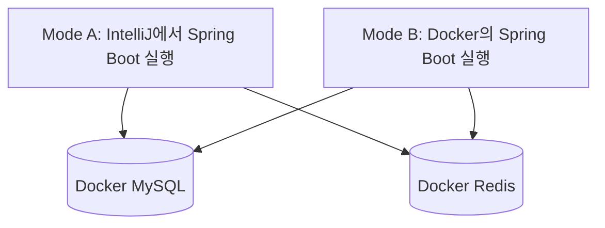

# Auth Lab

Spring Boot 기반의 **인증(Authentication)·인가(Authorization)·멀티테넌트(Multi-Tenancy) 학습 프로젝트**입니다.

일반 이메일 로그인과 Google OAuth2/OIDC를 하나의 사용자 계정에 연결하고, JWT·Redis를 이용한 로그인 세션 관리 및 여러 조직에 소속된 사용자의 권한 분리를 단계적으로 구현하는 것이 목표입니다.

> **현재 단계:** 개발 환경 구성 완료 (STEP 6-2). **Mode A와 Mode B 모두 실행 및 연결 확인 완료.** 회원가입·JWT·Google 로그인·테넌트 업무 기능은 아직 구현 전입니다.

## 1. 기술 스택

| 분류              | 기술                                                        |
|-----------------|-----------------------------------------------------------|
| Language        | Java 25 (Eclipse Temurin)                                 |
| Framework       | Spring Boot 4.1.2                                         |
| Build           | Gradle (Groovy DSL)                                       |
| Web / Security  | Spring Web MVC, Spring Security                           |
| Persistence     | Spring Data JPA, MySQL 8.4                                |
| In-memory Store | Redis 8                                                   |
| Infrastructure  | Docker, Docker Compose                                    |
| Development     | IntelliJ IDEA, Git, GitHub                                |
| 예정              | Flyway, JWT (Resource Server), Google OAuth2/OIDC, 통합 테스트 |

## 2. 프로젝트 목표

- 이메일·비밀번호 회원가입 및 로그인, 6자리 이메일 인증(5분 유효)
- Google OAuth2/OIDC 로그인 및 기존 계정과의 **수동 연동**
  - 서비스 로그인 이메일과 Google 이메일이 달라도 명시적 연동 허용
  - Google 계정 식별에는 이메일이 아닌 OIDC `sub` 사용
- 공통 `TokenService` 기반 JWT Access Token 발급
- Redis 기반 Refresh Token 관리, Rotation 및 로그아웃
- 하나의 사용자가 여러 테넌트에 소속되는 N:M 모델
  - 조직별 `OWNER` / `ADMIN` / `MEMBER` 역할 관리
  - API 요청은 하나의 테넌트 범위에서 처리하고, 소속·권한·데이터 접근 검증
- 간단한 공지사항 도메인을 통한 테넌트 간 데이터 격리 테스트

**DB 방식:** Shared Database + Shared Schema. `users`와 테넌트 소속을 분리하며, 테넌트 소유 데이터는 `tenant_id`로 구분할 예정입니다.

> `branches` 및 `branch_memberships`는 **DB 설계에만 반영**했습니다. 지점 관련 테이블 생성·Entity·API 및 지점별 역할은 이후 단계에서 구현할 계획입니다.

## 3. 개발 환경 구성

Spring Boot 실행 방식을 두 가지로 지원합니다. 두 모드는 **동일한 Docker MySQL·Redis 컨테이너와 데이터 볼륨**을 사용합니다.



| 항목             | Mode A — 로컬 개발       | Mode B — 전체 Docker    |
|----------------|----------------------|-----------------------|
| Spring Boot    | IntelliJ에서 Run/Debug | Docker 컨테이너           |
| MySQL          | Docker               | Docker                |
| Redis          | Docker               | Docker                |
| 목적             | 기능 개발 및 브레이크포인트 디버깅  | 컨테이너 빌드·네트워크·통합 실행 검증 |
| Spring Profile | `local` (기본값)        | `docker`              |

### 포트 및 접속 주소

| 서비스         | Mac 호스트에서 접근             | Docker 내부에서 접근  |
|-------------|--------------------------|-----------------|
| Spring Boot | `http://localhost:18080` | `backend:18080` |
| MySQL       | `127.0.0.1:23316`        | `mysql:3306`    |
| Redis       | `127.0.0.1:26379`        | `redis:6379`    |

컨테이너 내부의 `localhost`는 해당 컨테이너 자신을 가리킵니다. 그래서 Docker 실행 시 MySQL·Redis 연결에는 **Compose 서비스 이름**을 사용합니다.

## 4. 실행 전 준비

필요한 도구:

- Git
- Docker Desktop (또는 Docker Engine + Docker Compose)
- IntelliJ IDEA 및 JDK 25: **Mode A**에서 필요
- **Mode B**만 실행한다면 호스트에 JDK·Gradle을 별도로 설치할 필요 없음

### 4-1. 환경변수 설정

프로젝트 루트에서 다음 명령어를 실행합니다.

```bash
cp .env.example .env
```

`.env`에 데이터베이스·Redis 비밀번호를 설정합니다. 예시는 다음과 같습니다.

```dotenv
MYSQL_DATABASE=auth_lab
MYSQL_USER=auth_user
MYSQL_PASSWORD=your_mysql_password
MYSQL_ROOT_PASSWORD=your_mysql_root_password
REDIS_PASSWORD=your_redis_password
```

랜덤 비밀번호 생성 예시:

```bash
openssl rand -hex 24
```

`.env`는 Git에 올리지 않습니다. 공유 가능한 변수 목록은 `.env.example`에 유지합니다. 이미 MySQL 데이터 볼륨을 생성했다면 `.env`의 초기화용 비밀번호를 변경하는 것만으로 기존 DB 계정 비밀번호가 자동 변경되지는 않습니다.

### 4-2. 설정 파일 역할

| 파일                       | 역할                                          |
|--------------------------|---------------------------------------------|
| `application.yml`        | 공통 애플리케이션 설정, 기본 Profile `local`            |
| `application-local.yml`  | IntelliJ 실행 시 호스트 포트 사용, 프로젝트 루트 `.env` 읽기  |
| `application-docker.yml` | Docker 서비스 이름(`mysql`, `redis`)으로 접속        |
| `compose.yaml`           | MySQL·Redis·backend 서비스 및 `full` Profile 정의 |
| `Dockerfile`             | JDK 25 빌드 / JRE 25 실행의 멀티스테이지 이미지           |
| `.dockerignore`          | 이미지 빌드 시 불필요한 파일과 비밀정보 제외                   |

## 5. Mode A — IntelliJ에서 Spring Boot 실행

평소 코드 작성 및 Spring Security 디버깅 시 사용하는 방식입니다.

**1. MySQL·Redis만 실행**

```bash
docker compose config --quiet
docker compose up -d
docker compose ps
```

`backend` 서비스에는 `full` Profile이 설정되어 있어 위 명령어만으로는 실행되지 않습니다.

**2. IntelliJ Run/Debug Configuration**

- Main class: `com.example.authlab.AuthLabApplication`
- JDK: Java 25
- Working directory: `$PROJECT_DIR$`
- Spring Profile: `local` (지정하지 않으면 기본 적용)

`application-local.yml`이 프로젝트 루트의 `.env`를 읽으므로 **Working directory를 프로젝트 루트로 설정**해야 합니다.

**3. IntelliJ에서 Run 또는 Debug 실행**

Spring Boot가 Mac에서 실행되고, MySQL·Redis는 Docker에서 동작합니다.

**4. 연결 확인**

```bash
curl -i http://localhost:18080/actuator/health
```

예상되는 전체 상태는 `"status":"UP"`이며, Health 응답에서 `db`, `redis` 항목이 모두 `UP`인지 확인합니다. 출력되는 구성요소는 설정과 환경에 따라 달라질 수 있습니다.

## 6. Mode B — Spring Boot까지 Docker에서 실행

Docker 이미지 빌드와 세 컨테이너의 통합 실행을 확인하는 방식입니다.

**1. IntelliJ에서 실행 중인 Spring Boot 종료**

호스트의 `18080` 포트를 Docker backend와 동시에 사용할 수 없으므로 먼저 종료합니다.

**2. 전체 빌드 및 실행**

```bash
docker compose --profile full up -d --build
```

**3. 컨테이너 상태·로그 확인**

```bash
docker compose --profile full ps
docker compose logs -f backend
```

로그 확인에서 `Ctrl + C`를 누르면 로그 출력만 종료되며 컨테이너는 계속 실행됩니다.

**4. API 및 JVM 확인**

```bash
curl -i http://localhost:18080/actuator/health
docker compose exec backend java -version
```

Spring Boot는 Docker 내부에서 `docker` Profile로 실행되며, MySQL은 `mysql:3306`, Redis는 `redis:6379`로 연결합니다.

## 7. 두 실행 모드 전환

**Mode B → Mode A**

```bash
docker compose stop backend
docker compose up -d
```

그다음 IntelliJ에서 Spring Boot를 실행합니다. MySQL·Redis는 계속 실행됩니다.

**Mode A → Mode B**

IntelliJ에서 Spring Boot를 먼저 종료한 뒤:

```bash
docker compose --profile full up -d --build
```

**Java 소스 수정 후 Docker backend만 재빌드**

```bash
docker compose --profile full up -d --build backend
```

`docker compose restart backend`는 변경된 Java 코드를 다시 빌드하지 않습니다.

**전체 종료(데이터 볼륨 유지)**

```bash
docker compose --profile full down
```

`docker compose down -v`는 MySQL·Redis 데이터 볼륨까지 삭제하므로 주의합니다.

## 8. 진행 현황

| 단계       | 내용                                                      | 상태           |
|----------|---------------------------------------------------------|--------------|
| STEP 1   | 요구사항 및 인증·테넌트 정책 설계                                     | 설계 초안 완료     |
| STEP 2   | ERD 및 DB 테이블 설계                                         | 설계 초안 완료     |
| STEP 3   | Spring Security·JWT·Google OIDC 아키텍처 설계                 | 설계 초안 완료     |
| STEP 4   | REST API 설계                                             | 설계 초안 완료     |
| STEP 5   | 전체 설계 검토 및 보완                                           | 검토 완료        |
| STEP 6-1 | Spring Boot 프로젝트 생성·초기 실행·GitHub 저장소 생성                 | 완료           |
| STEP 6-2 | Mode A: IntelliJ + Docker MySQL/Redis                   | **실행 확인 완료** |
| STEP 6-2 | Mode B: Spring Boot + MySQL + Redis 전체 Docker           | **실행 확인 완료** |
| STEP 6-3 | Flyway 마이그레이션 및 DB 7개 핵심 테이블 생성                         | 예정           |
| 이후       | JPA Entity, 일반 회원 인증, JWT/Redis, Google OIDC, 멀티테넌트 API | 예정           |

### 다음 작업

1. Flyway 마이그레이션 도입 및 인증 테이블 생성
2. 테넌트·소속·초대·공지 테이블 생성
3. JPA Entity 매핑 및 스키마 검증
4. 일반 회원가입과 이메일 인증부터 기능별로 개발
5. JWT + Redis → Google OIDC → 멀티테넌트 순서로 구현 및 테스트

지점(`branches`, `branch_memberships`)은 현재 **설계만 완료한 확장 범위**이며 위 구현 단계에는 포함하지 않습니다.

## 9. 개발 및 Git 규칙

- 개인 학습용 Repository로, 당분간 별도 Issue·기능 브랜치·Pull Request 없이 **`main`에 직접 커밋 및 Push**합니다.
- 변경 내용은 가능한 한 기능·설정 단위로 커밋합니다.
- `.env`, OAuth Client Secret, JWT 개인키 등의 민감정보는 Git에 올리지 않습니다.
- README는 구현 단계가 끝날 때마다 실제 완료한 내용으로 갱신합니다.

```bash
git status
git add .
git diff --cached --stat
git commit -m "docs: document development environment and progress"
git push
```

---

**학습 방향:** 기능을 빠르게 나열하기보다 인증 흐름·토큰 수명주기·테넌트 데이터 격리의 원리를 이해하고, 테스트로 검증하면서 단계적으로 구현합니다.
